# Dossier


Dossier is a native macOS app that shows you what your Mac's on-device knowledge and
personalization stores hold about you: the personal knowledge graph, the interest profile,
who you talk to, the copies of your mail kept in search indexes, app and media activity,
places and devices, what Photos inferred, and the raw event streams underneath. It reads
those stores where they lie, strictly read-only, and sends none of it anywhere.

<picture>
  <source media="(prefers-color-scheme: dark)" srcset="docs/images/overview-dark.png">
  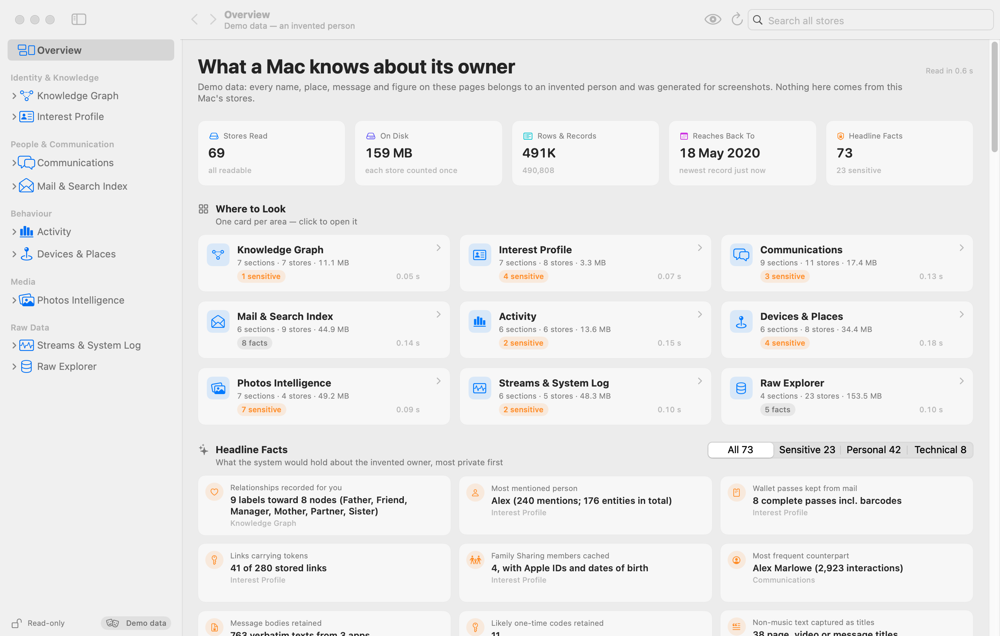
</picture>

It is written in Swift and SwiftUI for macOS 15 and later (sidebar, tables, Swift Charts,
MapKit, inspectors, light and dark appearance, no web views), has no third-party
dependencies, and ships as a universal (Apple silicon + Intel) app.

## Install

<p>
  <a href="https://github.com/dwahdany/dossier/releases/latest"></a>
</p>

Dossier needs macOS 15 or later, on Apple silicon or Intel, and
[Full Disk Access](#full-disk-access).

| | Direct download | Build from source |
|---|---|---|
| **Updates** | Download the new release | `git pull` and rebuild |
| **Signature** | Developer ID, notarized | Ad hoc |
| **Full Disk Access** | Granted once | Granted again after every rebuild |

### Direct download

1. Download `Dossier-<version>.dmg` from the
   [Releases page](https://github.com/dwahdany/dossier/releases).
2. Open it and drag Dossier to Applications.
3. Open Dossier and grant [Full Disk Access](#full-disk-access) when it asks.

Release builds are signed with a Developer ID and notarized by Apple, so they open without
a Gatekeeper warning.

### Build from source

You need a Swift 6 toolchain (Xcode 16 or later); there is no `.xcodeproj`, the package
builds with SwiftPM.

```sh
git clone https://github.com/dwahdany/dossier && cd dossier
scripts/make-app.sh                    # build/Dossier.app, ad-hoc signed, with icon
swift run -c release Dossier           # or start it straight from a terminal
```

`scripts/make-app.sh` needs no signing identity, no keychain, no sudo and no network.
[DEVELOPMENT.md](DEVELOPMENT.md) covers the build options, the self-test, the UI test, the
screenshot harness, signing and releasing, and the architecture.

## Features

Each sidebar area reads one family of stores. The app explains on every page which store
the data comes from and, where it is the system's inference rather than something you
entered, says so and shows the confidence or score the store holds.

| Area | Sections | Backed by |
|---|---|---|
| **Overview** | Totals, one card per area, headline facts ranked most private first | every area's summary |
| **Knowledge Graph** | Me, Entities, People & Relationships, Graph View, Events, Derived Views & Inferences, Ontology | `~/Library/IntelligencePlatform` (`graph.db`, `ontology.db`, `Artifacts/…` entity tagging, relevance, features, inferred triples, views) |
| **Interest Profile** | Summary, Topics, Named Entities, Places, Found in Mail, Contacts Intelligence, Vocabulary & Identifiers | `~/Library/PersonalizationPortrait`, `~/Library/Suggestions`, `~/Library/Assistant` (speech vocabulary), keyboard language modeling, Family Sharing cache, `~/Library/Trial` |
| **Communications** | Summary, People, Conversations, Messages Timeline, Calls, Other Siri Memories, Mail & Meeting Contacts, Retained Content, Recents, VIPs & Favourites | Siri Remembers `view.db` (IntelligencePlatform artifacts), knowledgeC `/app/intents`, `/private/var/db/CoreDuet/People/interactionC.db`, CallHistoryDB, CoreRecents, iCloud key-value cache |
| **Mail & Search Index** | Summary, Cascade Entities, Semantic Index, Spotlight Knowledge, Harvesting Pipeline, iCloud Key-Value Cache | `~/Library/Biome/sets` (Cascade sets: mail entities, body text, attachments, reminders, contacts, …), the hybridsearchd daemon container (Kuzu index), `~/Library/Metadata/CoreSpotlight/SpotlightKnowledge`, ProactiveHarvesting / TextUnderstanding Biome streams, the kvs daemon container |
| **Activity** | Summary, App Usage, Timeline, Media History, Web Usage, Predictions & Routine | Biome `App.InFocus`, `ScreenTime.AppUsage`, `Media.NowPlaying`, `App.WebUsage`, `Safari.*`; knowledgeC; `~/Library/DuetExpertCenter` |
| **Devices & Places** | Places Map, Networks & Radios, My Devices, Actions Log, Focus Modes, Notifications & Signals | Biome device, notification, screenshot, intent and discoverability streams; `~/Library/Biome/sync/sync.db`; DuetExpertCenter Focus caches; kvs (Wi-Fi networks, locations); milod; linkd |
| **Photos Intelligence** | Summary, People & Faces, Graph Inferences, Places & Trips, Search Index, Captions & OCR, Memories & Sharing | `Photos Library.photoslibrary`: `database/Photos.sqlite`, `database/search/psi.sqlite`, `private/com.apple.photoanalysisd/…/photosgraph*.kgdb`, `private/com.apple.mediaanalysisd/…/MediaAnalysis.sqlite`. Only the library's databases are read; photo and video files are never opened or decoded. |
| **Streams & System Log** | Stream Catalogue, Stream Records, Unified Timeline, knowledgeC, AI Telemetry, Device Sync | `~/Library/Biome/streams` (local and synced-device segments), `~/Library/Biome/sync`, DuetExpertCenter streams, the linkd App Intents transcripts, `~/Library/Application Support/Knowledge/knowledgeC.db` |
| **Raw Explorer** | Stores, SQLite Explorer (browse, schema, read-only SQL console), Biome Stream Explorer, Files & Plists | every known store, without interpretation |

- **Knowledge Graph.** The node the system marks as you, with every name, alias, handle,
  relationship and place attached to it and the systems each statement came from
  (Contacts, Photos, Calendar, Family Sharing); all other entities, a graph view, calendar
  and life events, and the derived views the system computes from the graph.

  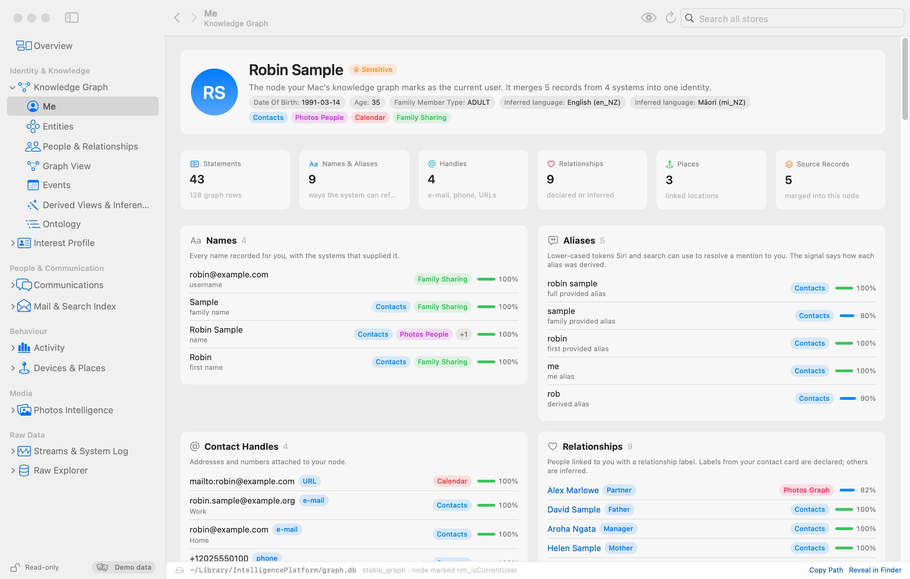

  For every person the system keeps a relationship model: a probability per relationship
  type, importance flags and a relevance score. Dossier puts that next to the label on your
  own contact card and marks where the two agree or disagree.

  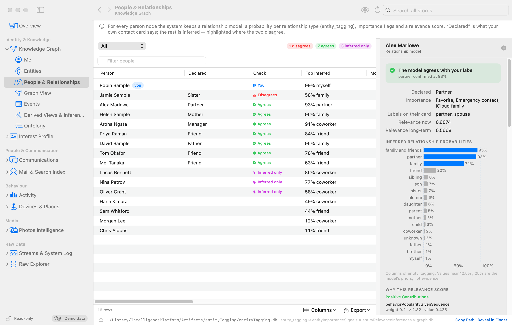

- **Interest Profile.** The topics, named entities and places the system extracted from
  what you write and receive, ranked by its own score and traced back to the apps the
  evidence came from; what was found in mail (contacts, events, wallet passes, links,
  snippets); learned vocabulary, identifiers and experiment assignments.

  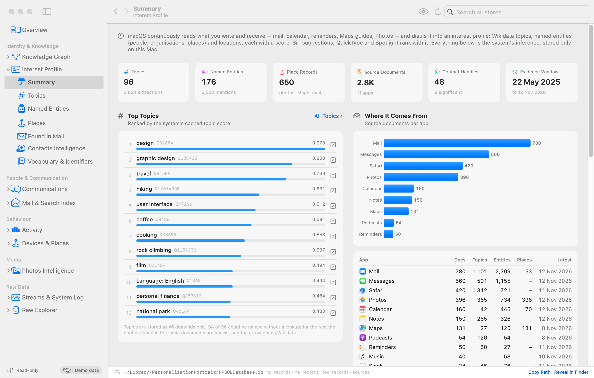

- **Communications.** Who the system knows you talk to, per person, conversation and app,
  from the interactions that messaging and phone apps donate to Siri; calls; mail and
  meeting contacts; and the content that is kept verbatim, such as message bodies, with
  likely one-time codes flagged.

  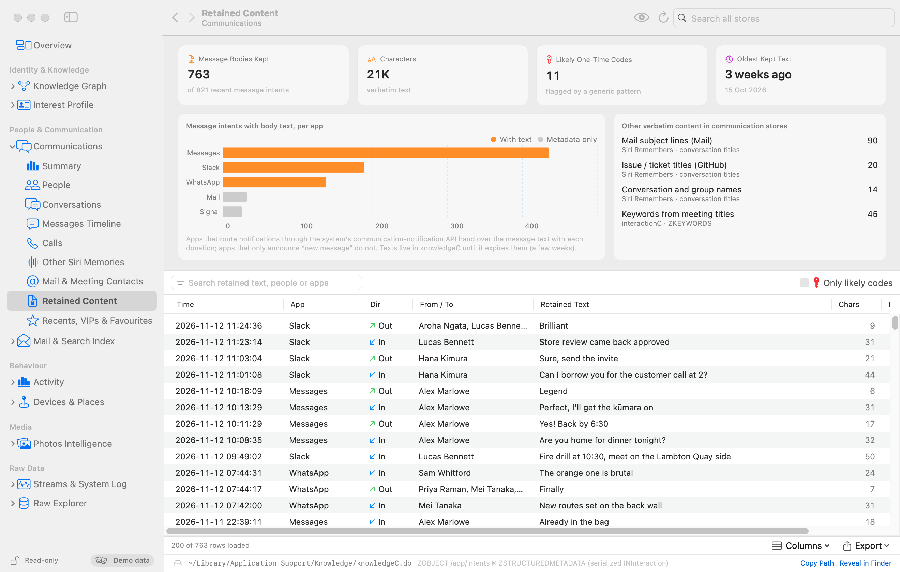

- **Mail & Search Index.** The copies of your mail that exist outside Mail: one entity per
  message and attachment with headers and body text in the Cascade sets, the semantic
  index, the Spotlight knowledge graph and the harvesting pipeline that feeds them.

  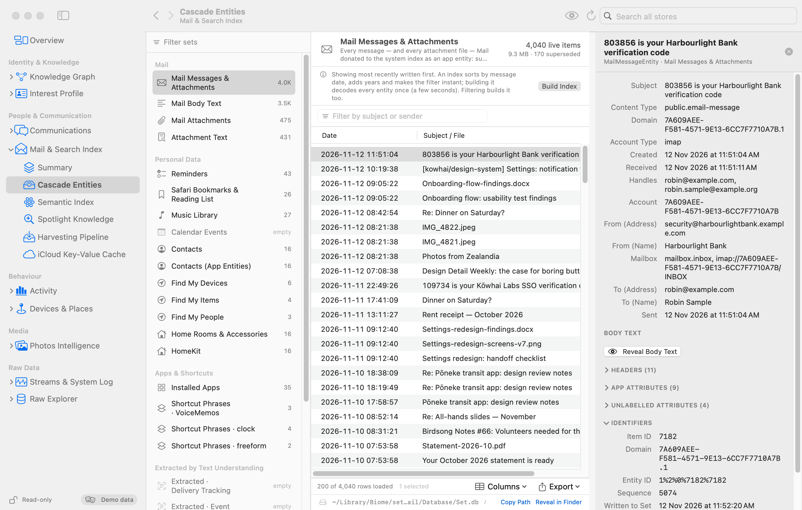

- **Activity.** Foreground time per app, a per-day timeline across your Mac and the devices
  that sync to it, media and web history, and what the system predicts you will do next.

  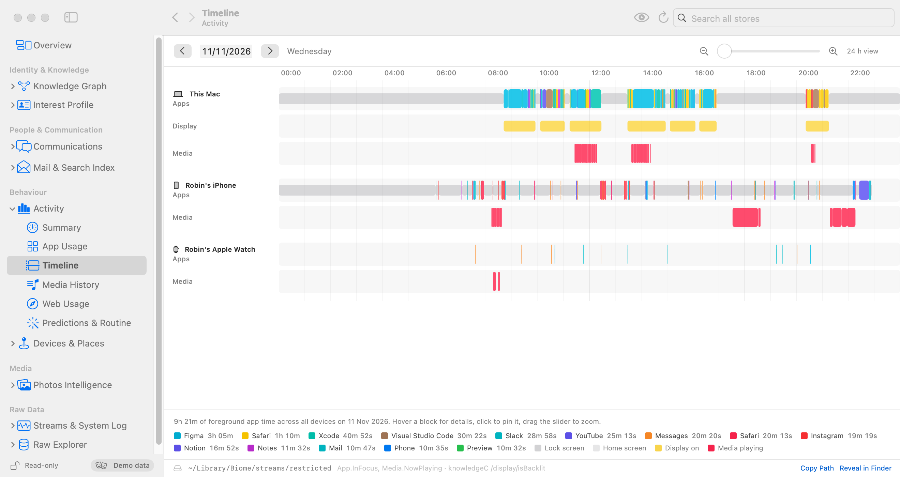

- **Devices & Places.** Every store that holds a location (calendar and reminder places,
  shortcut geofences, Focus triggers, Maps destinations, Wallet addresses, app activity),
  Wi-Fi and Bluetooth history, your devices and what syncs between them, Focus modes,
  notifications and an actions log.

  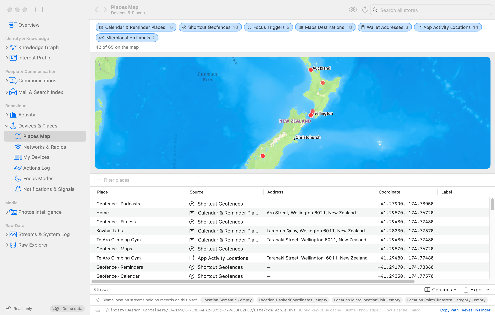

- **Photos Intelligence.** What Photos derived from the library's databases: people and
  face clusters, the graph's inferences (who you are, where you live and work, who matters
  to you, trips), the search index, captions and recognised text, memories and sharing.
  Photo and video files are never opened.

  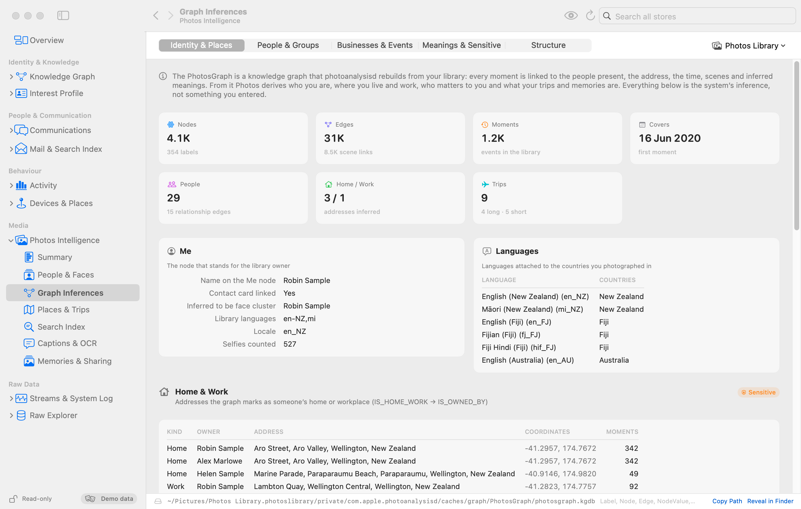

- **Streams & System Log.** The Biome event streams and knowledgeC as a catalogue, per
  stream, and merged into one timeline across devices; the telemetry about on-device AI
  models; and what syncs between your devices.

  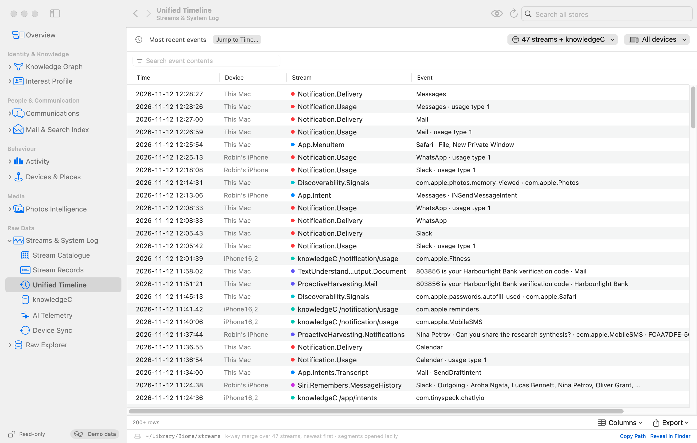

- **Raw Explorer.** Every known store without interpretation: all SQLite databases with a
  table browser, schema view and a read-only SQL console, every Biome stream record, and
  plists, keyed archives and protobuf files as trees.

  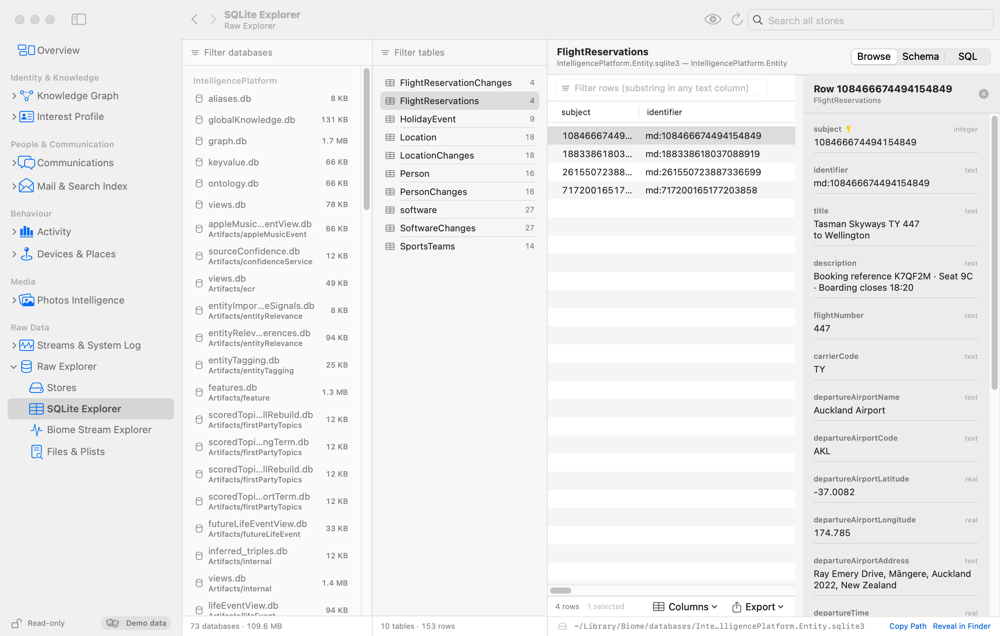

- **Search everything.** The toolbar's search field queries all areas at once; a hit opens
  the matching section and row.

  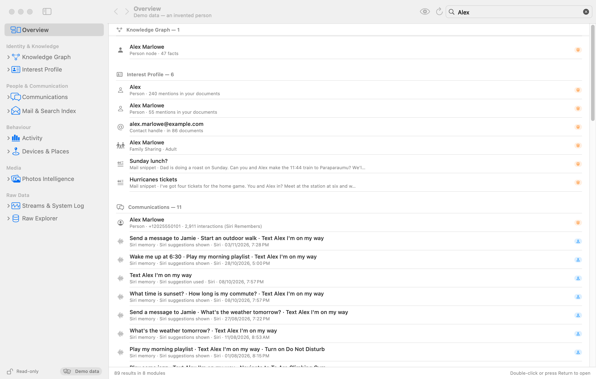

- **Privacy Mode** (⇧⌘P) blurs personal and sensitive values and replaces maps with a
  placeholder, so the window can be shared on screen.
- **Export.** Tables copy as TSV (⌘C) and export as CSV.

## Full Disk Access

Almost all of these stores are protected by macOS. Without Full Disk Access Dossier shows
a permission screen and, if you continue anyway, marks the stores as inaccessible.

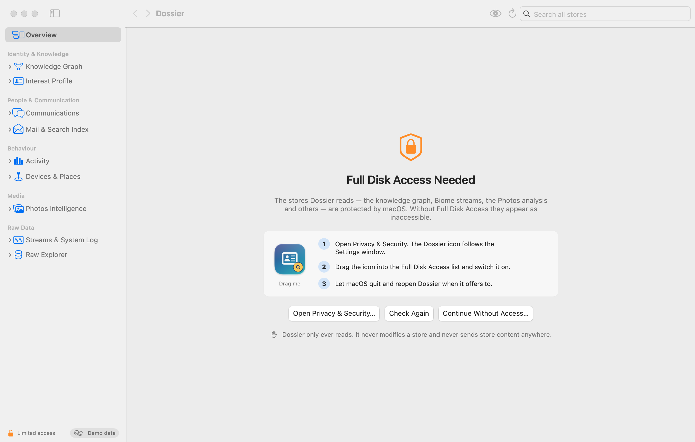

- **Running `Dossier.app`:** choose "Open Privacy & Security…" on the permission screen.
  A small panel with the Dossier icon follows the System Settings window; drag the icon
  into the Full Disk Access list and switch it on. macOS may offer to quit and reopen
  Dossier; let it. If it does not offer, Dossier notices the grant by itself.
  A locally built bundle is signed ad hoc, so its identity changes with every rebuild
  and the permission has to be granted again after rebuilding; release builds keep it.
- **Running from a terminal** (`swift run`, or the binary directly): the terminal
  application is the one that needs Full Disk Access; the binary inherits it.

Dossier never asks for administrator rights and never tries to change permissions itself.

## Privacy

Dossier collects nothing and sends no store content anywhere. The details
([PRIVACY.md](PRIVACY.md) is the short version):

- **Read-only.** SQLite databases are opened with `SQLITE_OPEN_READONLY` through the URI
  `file:<path>?mode=ro&readonly_shm=1`, with `PRAGMA query_only=ON` and an authorizer
  that rejects everything but reads, including in the SQL console. No index is created,
  nothing is vacuumed or checkpointed, and no `-shm` file is created or written. If a
  database cannot be opened that way, Dossier falls back to an immutable snapshot of
  the main file and labels the result as possibly stale. Stream and set files are
  memory-mapped read-only.
- **Network.** The only network use is MapKit downloading Apple map tiles for the area
  a map shows, which tells Apple's tile servers roughly which region is being viewed.
  Privacy Mode replaces maps with a placeholder. Dossier itself sends no store content
  anywhere; there is no telemetry, no update check and no web view. Topic names come from
  tables on the Mac and a list compiled into the app, not from lookups. The Interest
  Profile's topic pages offer an optional "Look up on Wikidata" link: clicking it opens
  your browser on wikidata.org with that one topic id. Nothing is looked up unless you
  click.
- **Persistence.** Dossier keeps no copy, cache or index of your data on disk; derived
  indexes (mail index, semantic-index scan) live in memory for the run. What it does
  write: a handful of preferences in its own user defaults (last section and whether to
  restore it, Privacy Mode and whether to start in it, collapsed sidebar groups, a table
  display option, a manually chosen Photos library path, and the window and column layout
  that macOS saves for any app), files you explicitly export or
  copy (CSV export, Copy), PNGs when you use `--snapshot` or `--screenshot`, PNGs and a
  `report.json` when you use `--uitest` (written to `--out <dir>`, by default a
  `dossier-uitest` folder in the temporary directory, and not removed afterwards), and
  scratch test databases in the temporary directory during `--selftest`, which are removed
  afterwards. MapKit may keep its own system-managed cache of downloaded map tiles.
- **No prompts.** No sudo, no AppleScript, no keychain access. One known gap: without
  Full Disk Access, macOS itself may ask whether Dossier may access data from other
  apps when a section reads inside another app's container; the app warns about this
  before continuing without access.

## Command line

The same binary (`.build/release/Dossier` or `Dossier.app/Contents/MacOS/Dossier`) has a
headless mode. With no arguments it starts the app.

```
--help                         every option
--list                         areas and section ids
--selftest [moduleID]          read every store, print PASS/WARN/FAIL per check and a
                               timing table; exit status 1 on any failure
--summary [moduleID]           stores (path, size, rows, time range) and headline facts
--search <query> [moduleID]    what toolbar search would return
--snapshot <sectionID|moduleID|overview|app> <out.png>
          [--dark] [--size WxH] [--scale 1|2] [--wait seconds]
          [--privacy] [--payload <deep link>]
                               render one section off-screen to a PNG; no window opens
--screenshot <sectionID|moduleID|overview> <out.png>
          [--dark] [--size WxH] [--scale 1|2] [--payload <deep link>] [--query <text>]
          [--select-row n] [--privacy] [--wait seconds] [--linger seconds]
                               the same for the whole window: title bar, toolbar, sidebar
--uitest [sectionID|moduleID|all] [--out <dir>] [--sizes WxH,WxH] [--query <text>]
          [--no-interactions] [--wait seconds] [--payload <deep link>] [--dark]
          [--screen WxH]
                               host the real app shell in an off-screen window, check
                               layout at several sizes, click, scroll, type and resize;
                               writes PNGs and report.json; exit status 1 on any failure
```

`Dossier --help` prints every option, and
[ARCHITECTURE.md §3 and §3a](ARCHITECTURE.md#3-build-self-test-snapshot) describe them.

`--summary`, `--search`, `--snapshot`, `--screenshot` and `--uitest` output contains
personal data. Keep it out of any repository (`*.png` and `*.csv` are git-ignored as a
safety net).

## Known limitations

- **Tested on one machine and one OS version** (macOS 27.2, Apple silicon). Schemas differ
  between macOS versions; Dossier probes tables and columns and degrades to "missing" or
  "inaccessible" states, but layouts on other versions are untested. The Intel half of the
  universal binary and macOS 15 are built for but untested.
- **Reverse-engineered formats.** None of these stores is documented. Biome SEGB
  framing, the protobuf payloads (decoded without schemas; typed column names exist for
  about 50 streams and are inferred from the data), CoreData enum codes, Photos face
  and memory codes, NSKeyedArchiver payloads and the Cascade set encoding are decoded
  heuristically. Labels can be wrong; the Raw Explorer shows the undecoded values.
- **Stores that stay opaque or out of reach.**
  - The hybridsearchd semantic index is a Kuzu database. It cannot be queried; Dossier
    only scans the file for JSON payloads that sit whole inside a page, on demand.
  - The classic Spotlight app-content index is listed by size but not decoded.
  - Embedding vectors are counted, not interpreted.
  - Screen Time's own database, the location daemon's store and the system-wide knowledge
    store are beyond Full Disk Access; they are listed as protected and never opened.
  - Anything else macOS denies even with Full Disk Access is shown as inaccessible.
  - Stores that exist only on other devices are visible only as far as they sync to
    this Mac.
- **Derived figures are estimates.** De-duplicating Now Playing events mirrored between
  devices, counting distinct notifications across two logs, naming devices that are
  missing from the sync database, and "seen with" context for topics are heuristics.
- **Live stores.** The system writes to these stores while Dossier reads them, so two
  views can differ by a few rows; Refresh (⌘R) re-reads.
- **Very wide tables** in the SQLite Explorer show 24 columns by default; showing all
  columns of a 100+ column table is slow.
- Filtering large non-mail Cascade sets decodes every item (with progress), and the
  first address filter in Photos decodes all reverse-geocode archives once.
- The interface is English only; dates and numbers follow the system locale.
- Builds you make yourself are signed ad hoc and not notarized, and need Full Disk Access
  granted again after each rebuild.
- Verification so far is automated (the self-test, the off-screen UI test, the screenshot
  harness). Hover, drag, context menus, menu-bar commands, keyboard shortcuts and the
  drag-the-icon permission flow are not covered by it.

## License

MIT — see [LICENSE](LICENSE).
